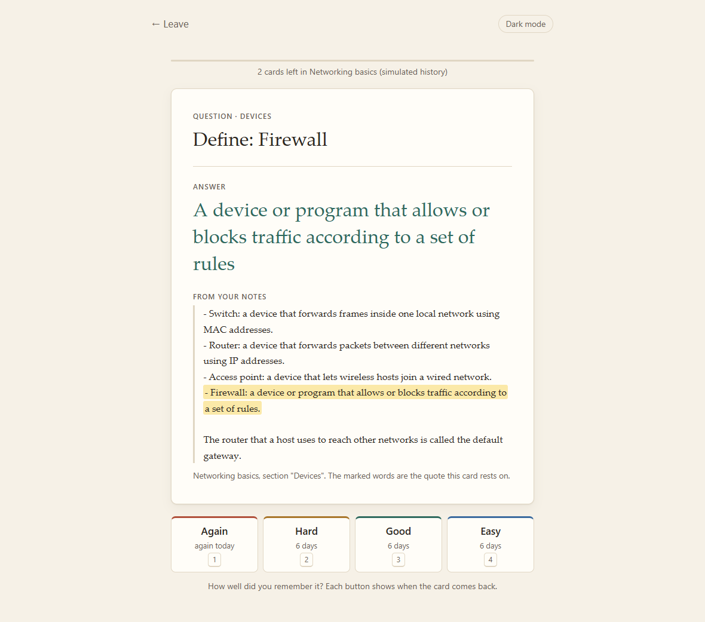
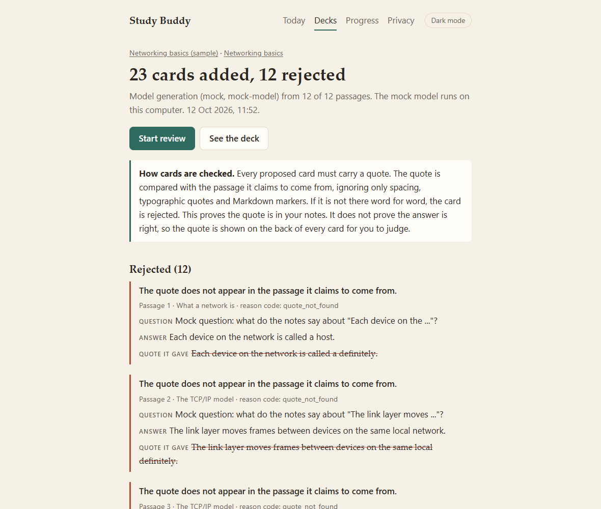
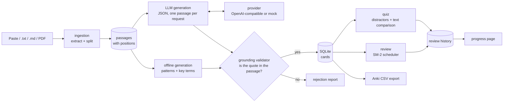
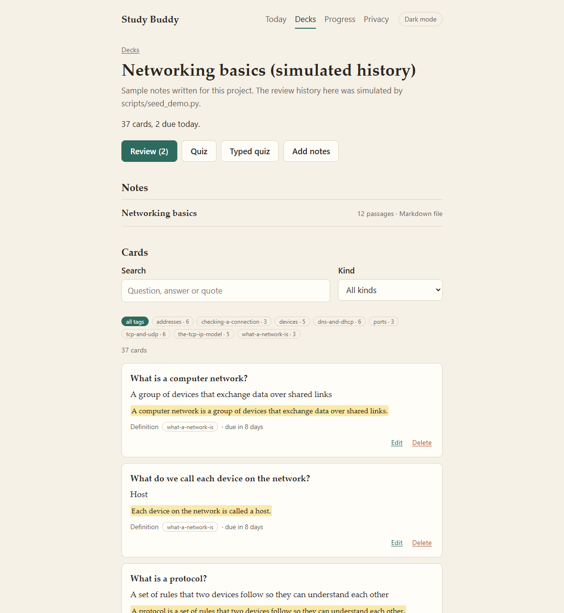
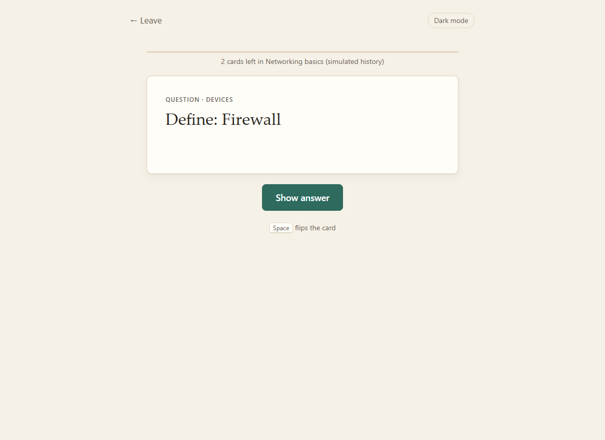
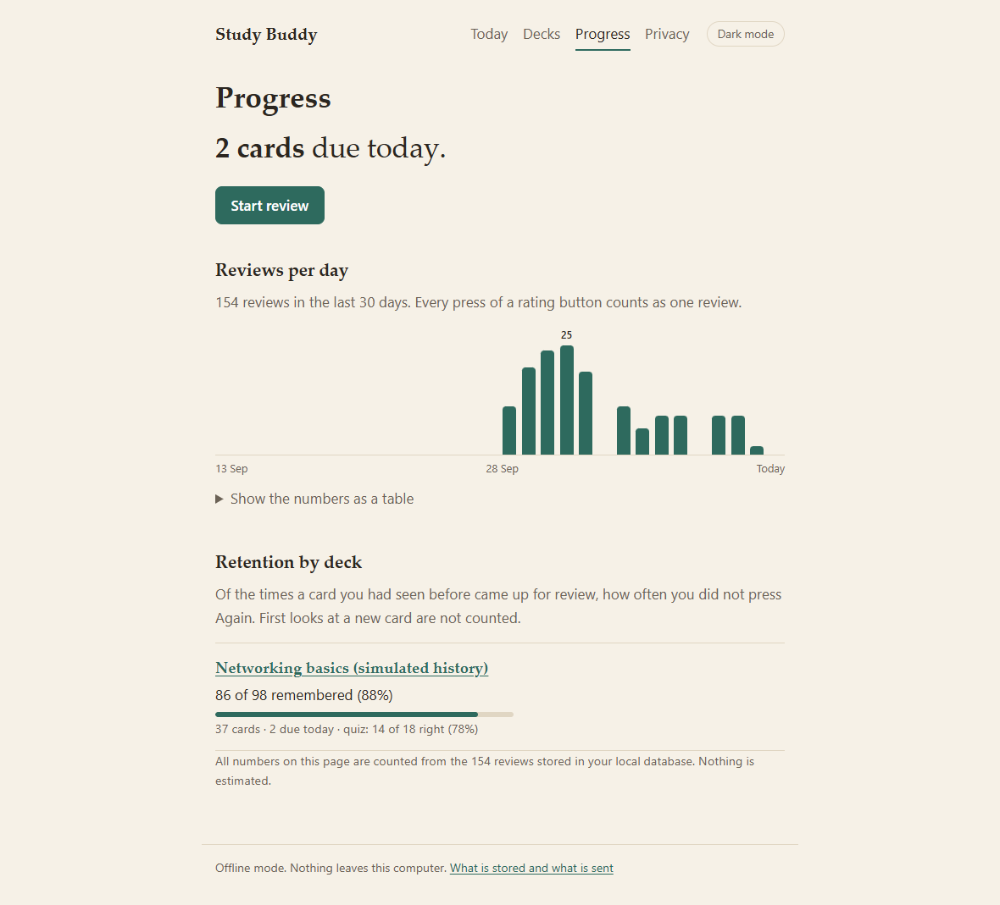
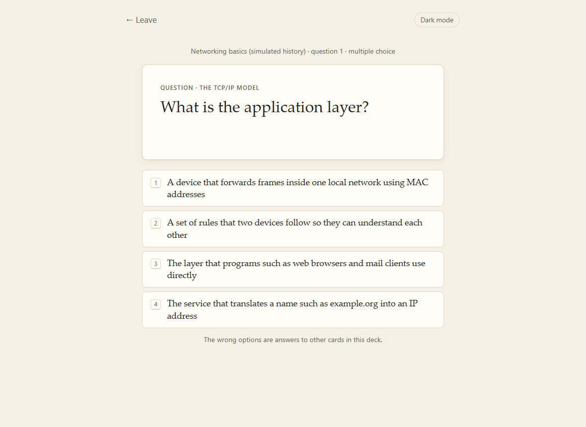
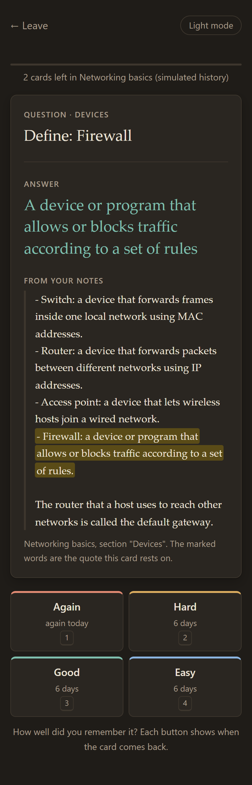

# Study Buddy

[](https://github.com/Omkar210404/study-buddy/actions/workflows/ci.yml)

A small local web app that turns study notes into flashcards and quizzes. Every card is tied to an
exact quote from the notes, and reviews are scheduled with the SM-2 spaced-repetition algorithm.



## The problem

Making flashcards by hand is slow, so people skip it. Generated flashcards are fast, but a generator
can state something the notes never said, and the learner then memorises it.

Study Buddy generates the cards and keeps them checkable:

- each card stores the passage it came from and a supporting quote
- a program verifies that the quote really appears in that passage before the card is saved
- the quote is shown on the back of the card, marked inside the passage, so you can judge the answer yourself

## What it does

- **Import notes** as pasted text, `.txt`, `.md` or a text-based PDF. Scanned PDFs are refused: the app
  does not do OCR.
- **Split the notes into passages**, with section titles where the notes have headings. Each passage
  keeps its character position in the source text (and the page number for PDFs).
- **Generate cards in two modes**
  - *Offline (default, no API key):* definition cards from sentence patterns such as "X is a ...",
    "X refers to ..." and "... is called X", and fill-in-the-blank cards where a key term is blanked.
    Key terms are picked by word counting with a few boosts. No model is involved.
  - *LLM (optional):* an OpenAI-compatible provider (for example Groq) returns question-answer cards as
    JSON. Each card is validated on its own and then goes through the grounding check.
- **Review with SM-2**: ease factor, interval and due date per card, four rating buttons, a daily queue.
- **Quiz**: multiple choice with wrong options taken from other cards in the same deck, and a
  typed-answer mode with a plain text comparison.
- **Manage decks**: several decks, edit or delete cards, tags, search.
- **Progress**: cards due today, reviews per day, retention by deck, counted only from your own history.
- **Export** a deck to a CSV file for Anki.

## How the grounding check works

The validator is one pure function, [`check_quote`](app/grounding/validator.py). It gets a quote and a
passage and answers one question: is this quote in this passage?

1. Both texts are normalised the same way ([`normalise.py`](app/grounding/normalise.py)):
   Unicode compatibility forms are folded, curly quotes become straight quotes, the different dashes
   become `-`, every run of whitespace becomes one space, and Markdown `**` and backticks are ignored.
   No word is changed and letter case is kept.
2. The quote must be at least 3 words and 12 characters, and at most 300 characters.
3. The normalised quote must be a substring of the normalised passage. There is no fuzzy matching: a
   quote with one word changed, with `...` in the middle, or taken from a different passage is rejected.
4. The match is mapped back to character offsets in the original passage, and that exact slice of the
   notes is stored as the supporting quote. What is saved is your text, not the model's retyping of it.

Offline cards go through the same function as LLM cards, and so does every card edit. A card that
fails is not saved. Rejected cards are stored with the reason and listed in a report after each run.



*This report comes from the built-in **mock** provider in its `mixed` mode, which returns some real quotes
and some altered ones on purpose. It shows the check working; it says nothing about how any real
model behaves.*

**What the check does not do.** It proves the quote exists in your notes. It does not prove that the
answer follows from the quote, and it does not judge whether the question is a good one. That is why
the quote is on the back of every card.

## Architecture



The scheduler, validator, splitter, offline generator, distractor picker and answer comparison are pure
functions with no database, clock or network access. [`app/services.py`](app/services.py) is the one
place where they meet storage, and the web layer only calls it and renders templates.

| Folder | Role |
|---|---|
| `app/ingestion/` | read text, Markdown and PDF; split into passages with offsets |
| `app/generation/` | `offline.py`, `terms.py` (offline mode); `llm.py`, `prompts.py` (LLM mode) |
| `app/grounding/` | normalisation and the validator |
| `app/llm/` | provider interface, OpenAI-compatible provider (httpx), mock provider, retry wrapper |
| `app/scheduler/` | `sm2.py` (the algorithm), `queue.py` (the daily queue) |
| `app/quiz/` | distractor selection, typed-answer comparison |
| `app/storage/` | SQLAlchemy models, engine, progress statistics |
| `app/export/` | Anki CSV |
| `app/web/` | FastAPI routes, Jinja2 templates, HTMX, CSS |

## Install and run

Needs Python 3.11 or newer.

```bash
git clone https://github.com/Omkar210404/study-buddy.git
cd study-buddy
python -m venv .venv
# Windows PowerShell:
.venv\Scripts\Activate.ps1
# macOS / Linux:
source .venv/bin/activate

pip install -r requirements.txt
python -m uvicorn app.main:app
```

Open http://127.0.0.1:8000 and press **Try it with the sample notes**, or create a deck and add your
own notes. No API key and no configuration are needed.

### Tests

```bash
pip install -r requirements-dev.txt
pytest -q
```

The suite has 206 tests and needs no internet: a fixture makes any attempt to resolve or connect to a
non-local host fail the test.

### A demo database with history

A fresh install has no review history, so the progress page starts empty. To see it filled in:

```bash
python scripts/seed_demo.py
# Windows PowerShell:
$env:DATABASE_PATH = "data/demo.db"; python -m uvicorn app.main:app
# macOS / Linux:
DATABASE_PATH=data/demo.db python -m uvicorn app.main:app
```

The script loads the sample notes into `data/demo.db` and replays two weeks of study through the real
queue and SM-2 code. The ratings are drawn from a fixed-seed random generator. They are simulated, and
the deck is named "Networking basics (simulated history)" so that is visible on every screen.

### LLM mode (optional)

Copy `.env.example` to `.env` and set:

```
LLM_PROVIDER=openai_compatible
LLM_BASE_URL=https://api.groq.com/openai/v1
LLM_MODEL=<a model your provider offers>
LLM_API_KEY=<your key>
```

Restart the app. Each set of notes then has a second button, "Generate cards with the model". To try
the LLM path without a key, set `LLM_PROVIDER=mock` and `MOCK_LLM_MODE` to `good`, `fake_quotes`,
`mixed` or `invalid_json`.

### Docker

```bash
docker build -t study-buddy .
docker run -p 127.0.0.1:8000:8000 -v studybuddy-data:/data study-buddy
```

The database is kept in the `studybuddy-data` volume. Docker is not installed on the machine this was
built on, so the image is built and health-checked by the CI workflow rather than locally.

## Screenshots

All screenshots are of the running app with the bundled sample notes, taken by
[`scripts/take_screenshots.py`](scripts/take_screenshots.py).

**Study view.** A deck with its notes, search, tags and cards. Each card shows its supporting quote.



**Review screen.** The front first; Space flips the card. The back shows the answer, the passage with
the quote marked, and the four rating buttons with the time until the card returns.



**Progress page.** The review history in this screenshot is **simulated** by `scripts/seed_demo.py`
(see above). The page itself only counts rows in the database, so on your machine it shows your own
reviews.



**Quiz** and the review screen on a phone-width window in dark mode:





## SM-2 in plain words

SM-2 decides how many days to wait before showing a card again. It keeps three numbers per card:

- the **interval**: days until the next review
- the **repetitions**: how many times in a row you remembered it
- the **ease factor**: how fast the interval grows for this card. It starts at 2.5 and never goes below 1.3.

After you see the answer, you press one of four buttons:

| Button | Meaning | Effect on ease |
|---|---|---|
| Again | I did not remember | −0.32, and the card starts over |
| Hard | I remembered with difficulty | −0.14 |
| Good | I remembered | no change |
| Easy | I remembered at once | +0.10 |

If you remembered, the next interval is 1 day the first time, 6 days the second time, and after that
the previous interval multiplied by the ease factor. So a card you keep remembering comes back after
1, 6, 15, 38, ... days, and a card you find hard comes back sooner. If you press Again, the count
starts over at 1 day.

A worked example, which is also a test in [`tests/test_sm2.py`](tests/test_sm2.py):

| Press | Ease after | Next review in |
|---|---|---|
| Good | 2.50 | 1 day |
| Good | 2.50 | 6 days |
| Good | 2.50 | 15 days (6 × 2.5) |
| Hard | 2.36 | 35 days (15 × 2.36 = 35.4) |
| Again | 2.04 | 1 day |
| Easy | 2.14 | 1 day |

Details of this implementation:

- SM-2 uses a 0 to 5 quality score. The buttons map to Again = 2, Hard = 3, Good = 4, Easy = 5.
- It is plain SM-2, without the learning steps, interval fuzz or easy bonus that Anki adds. Hard and
  Good therefore give the same interval for the next review and differ only through the ease factor.
- A card rated Again comes back at the end of the same session. Those repeat ratings are logged but do
  not change ease or interval again; only the first rating of a due card moves the schedule.
- At most 20 new cards per deck are introduced per day (`NEW_CARDS_PER_DAY`).

## Quiz mode

**Multiple choice.** The right answer is the card's own answer. The wrong options are answers to other
cards in the same deck. Answers equal to the right one are never used, nor is text already visible in
the question. Options that look like the right answer are preferred: a number for a number, the same
kind of card, a similar length. A deck needs at least two cards with different answers.

**Typed answer.** Your text is compared with the card's answer by a simple string comparison
([`similarity.py`](app/quiz/similarity.py)). It is not graded by a model and it does not understand meaning.

1. Both strings are lower-cased, punctuation becomes spaces, extra spaces are removed and a leading
   "a", "an" or "the" is dropped.
2. If they are now equal, the answer is correct.
3. Otherwise Python's `difflib.SequenceMatcher` gives a similarity ratio from 0 to 1. A ratio of 0.85 or
   more counts as correct, which forgives a typo or a plural ("encapsulaton", "routers").
4. If the expected answer contains a digit, only an exact match counts, because `192.168.1.21` is not a
   typo of `192.168.1.20`.

The result screen shows both strings, the ratio, and a button to overrule the verdict. Quiz answers are
practice: they are logged for the progress page and never change the review schedule.

## Anki export

Each deck page has "Download this deck as a CSV for Anki". The file has three columns (Front, Back,
Tags) and the header lines Anki's text importer understands (`#separator`, `#html`, `#columns`,
`#tags column`). The Back field holds the answer followed by the supporting quote. In Anki, use
File → Import.

Review history and scheduling are not exported, because Anki's text import has no place for them.
The file format is covered by unit tests, but the import itself has not been tried in Anki from this
machine.

## Privacy

- **Everything is stored locally** in one SQLite file (`data/studybuddy.db` by default): the text of
  your notes, the passages, the cards and your review and quiz history. Uploaded files are read once and
  not kept. There are no accounts and no analytics.
- **Offline mode sends nothing.** Import, generation, review, quizzes, progress and export all run on
  your machine. The pages load no fonts or scripts from other sites; HTMX is served from the app itself.
- **LLM mode sends only the passages being processed.** When you press "Generate cards with the model",
  the text of up to 20 passages from that set of notes (`LLM_MAX_PASSAGES_PER_RUN`) is sent to the
  provider you configured, one request per passage, together with the section title and the
  instructions. Your other notes, cards, history and file names are not sent. What the provider does
  with the text is governed by its own terms.
- **Keys come from environment variables only.** The key is used in the request header to the provider
  and is never written to the database, logged or shown on a page.
- **Real notes are never committed.** `data/`, `uploads/`, `*.db` and `.env` are in `.gitignore`. The
  only notes in the repository are the synthetic sample in `sample_notes/`, written for this project.

The app has no login and is meant to run on your own computer, bound to `127.0.0.1`. It refuses
state-changing requests that come from another site. Do not expose it to the internet.

## Limitations

- **Text PDFs only.** Scanned PDFs and images are not supported; there is no OCR. PDFs with columns,
  tables, running headers or equations can extract in a jumbled order.
- **Offline card quality is basic.** The generator matches sentence patterns and counts words. It
  misses definitions phrased in other ways, and it sometimes blanks a word that is not the point of
  the sentence. Expect to edit or delete some cards.
- **LLM card quality depends on the model.** The grounding check removes cards with invented quotes,
  but a card can quote a real sentence and still ask a weak question or give a wrong answer.
- **LLM mode has not been run against a real provider here.** No API key was available while building
  this, so that path is tested with the mock provider and a fake HTTP transport only.
- **The quote check is strict.** A model that changes capitalisation or shortens a quote gets the card
  rejected, even when the card itself is fine.
- **English only.** The sentence splitter, stop-word list and definition patterns assume English.
- **Section detection in plain text is a guess.** Markdown headings are reliable; for plain text the
  app looks for short title-like lines and can miss or misread them.
- **Single user, no sync.** One local database, no accounts, no backup, no mobile app.
- **Plain SM-2.** No learning steps, no per-deck settings, no undo for a rating.
- **No manual card creation.** Cards come from notes so that every card has a source passage.

## Future ideas

- Mark the answer inside the quote, and warn when an answer shares no words with its quote
- Export fill-in-the-blank cards as Anki's Cloze note type
- OCR as an optional import step for scanned PDFs
- Undo for the last rating, and a per-deck daily limit
- Import from an existing Anki deck
- Run a real provider on the sample notes and report how many cards pass the grounding check

## License

MIT. See [LICENSE](LICENSE). HTMX is bundled in `app/web/static/` under its own Zero-Clause BSD license.
